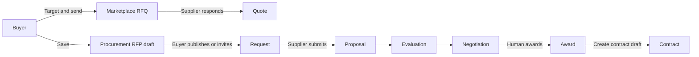

## 20 November 2026: paginated recommendations and saved evaluation popups

See [tender popup verification](marketplace-tender-popup-verification.md) for implementation, live AI fixture verification, regression results and rollback details. No migration or deployment.

## 20 November 2026: dashboard slow-response recovery

Reported successful dashboard, Agent summary and proposal inbox responses took 41–51 seconds, exceeding the generic 30-second browser timeout. The dashboard now uses a 90-second budget and requests its composed summary once; the separate Agent endpoint is only a fallback. Fallback loading does not delay the retry control or hide an available Agent panel. Tender recommendations render independently during dashboard loading and failure.

Exchange rates are refreshed against the already authorised business record before summary calculations, avoiding the second full composition and repeated policy, task, billing and business reads. The Agent endpoint reuses its existing entitlement rather than reading it again. Workspace checks still precede the refresh. No schema or configuration change; rollback is a code revert.

Verification: 45 backend dashboard/currency/access regression checks passed. All 13 frontend dashboard/recommendation regression checks passed, including a successful response after 51 seconds and independent failure recovery. Production build passed with existing CSS minification and bundle-size warnings. Live database latency has not been remeasured; the reported inbox latency remains a separate observation. No deployment or push. Carry forward live AI generation, real signup email verification, connected buyer-to-contract and full payment lifecycle verification.

# Marketplace procurement Sprint 0 handoff

This is a checkout audit. The source PRD reports eight production workflows. Production operation of each workflow has not been independently verified.

| Workflow | Entry point and record | Disposition |
| --- | --- | --- |
| Directory and profiles | MarketplacePage and DirectoryProfilePage use the directory router and marketplace_directory_profiles. Public projection filters publication and visibility. | Existing. Extend sourcing eligibility without changing public browsing. |
| Claim and verification | DirectoryService tracks claims, verifications and invitations and links the profile to a workspace. | Existing. Regression check that claiming never exposes the previous holder's records. |
| RFQ | Marketplace service writes targeted RFQs under workspaces.data.financials.rfq_requests. Directory held requests use separate storage until claimed. | Extend. Trace buyer-owned drafts and consistent sent IDs before adding draft persistence. |
| Public/private RFP | Proposals router uses workspaces.data.proposal_requests. Create is DRAFT; separate actions publish, invite, close and reopen. | Existing. Reuse creation from sourcing. Verify private visibility and invitation isolation. |
| Proposal submission | Proposals service keeps submission, inbox, requirements, activity and permitted status transitions. | Existing. Keep existing IDs and permissions. |
| Evaluation and award | Business Operations Evaluations reads proposal statuses. Proposals service moves NEGOTIATION to AWARDED. | Extend. Identify authoritative criterion scores, reviewer overrides and evidence storage before adding comparisons. |
| Award to contract | Proposals status progression includes CONTRACT_DRAFTED and CONTRACTED. | Existing transition. Verify the contract record and agreement/signing handoff end to end. |
| AI generation | Proposals router has generate-description, extract-brief and generate-cover-letter, using shared model selection. | Extend with validated structured extraction and preserve manual forms. |
| Tender discovery | No tender changes in this slice. | New. Verify official pagination and applicable reuse conditions before live integration. |
| Recommendations, alerts, analytics and pricing | Follow-on work. | Defer. |

## Delivery and acceptance

1. Keep the current public directory routes and use the login return path for sourcing. Check anonymous browse and both sign-in and registration return. Only the fixed route belongs in the return URL.
2. Use the existing model provider and RFP draft endpoint. Require workspace access before invoking the model or reading matches. Verify unauthenticated rejection, cross-workspace denial, and identical matching results from both entry points. Verify the saved RFP appears with the same ID in Business Operations and never publishes or invites on save.
3. Keep search authoritative for public visibility. Check opt-outs, exclusions, geography, explicitly listed service names and credentials. The initial matcher is rules based. No credential is inferred from ownership. Add richer coverage, evidence, logged ranking inputs and match version before accepting the full matching scope.
4. Introduce evidence comparison only after locating the authoritative evaluation schema. Keep AI output as suggestions and validate every cited quote against actual proposal text, with a document and page/section anchor where available. Preserve original figures. Verify manual review after provider failure, override audit and human award/signing.
5. For public tenders use additive, RLS protected storage for release history, procurement/lot state, quarantine, sync health, and tenant-scoped watchlists. Preserve official identifiers and URLs. Run immutable time windows with pagination and only advance the checkpoint after all pages commit. Replay fixtures twice and verify deduplication, amendments, closures, expired deadlines, malformed records, hidden records and watchlist isolation. Only then verify the live feed. Initial source documentation: https://www.gov.uk/government/publications/open-contracting and https://www.find-tender.service.gov.uk/apidocumentation/1.0/GET-ocdsReleasePackages .
6. Release after the eight regression workflows and approval/authorization gates pass. This slice has no migration. Roll back by removing the sourcing entry points and endpoints; leave any saved procurement drafts in the existing workspace record.

## Gaps recorded after slice 1

RFQ drafts and audit history are not wired. Existing RFP create/save/publish calls remain distinct. Matching does not currently persist inputs, calibrate results or fill gaps in supplier evidence. The evaluation extension and public tender experience are pending. No feed is connected.

## Sourcing slice 2

- Procurement stores RFQ and RFP drafts in the existing proposal request collection. A buyer confirms the kind before saving. A client-generated request ID stays fixed through save retries, edits, and reopening the same draft in Business Operations. The save path writes only the draft and audit history. It never calls publishing, invitations or RFQ delivery.
- A sourced RFQ is sent only after explicit approval for a listed supplier with RFQs enabled. The existing Marketplace RFQ service uses the draft ID for the recipient RFQ and the buyer's Sent RFQs entry. The draft records the approved supplier before sending, so a retry cannot redirect it. If a delivery resets partway, reopen the draft and retry its original recipient. Unclaimed profiles still use their existing separate public request flow.
- Sourced RFP publish and invite approvals use existing Procurement actions. An unpublished sourced draft cannot send invitations. The published public projection does not disclose the sourcing history.
- Workspace data includes sourcing generation, brief, meaningful revisions and approvals following the proposal event convention. The history records actor, workspace, request ID, timestamp and prompt version for generation. Sourcing history uses workspace retention and deletion. There is no independent expiry or migration. Historical RFP drafts without sourcing metadata continue using the original editor.
- Before the implementation, the isolated claim activation regression failed on the same assertion reported in slice 1. Current claim settings default RFQs on when there is no explicit preference. The activation checklist considers a default-enabled mode sufficient. Updated the test to assert the default explicitly and to expect only description and service area to remain incomplete. No production claim logic changed.
- Focused backend fixtures passed 70 tests, including same-ID reopen, unchanged save retry, cross-workspace denial, explicit RFQ approval and repeat send. Existing contract tests passed within that run. This is not an end-to-end live buyer-to-contract transaction.
- Three Chromium tests with fixture APIs verified anonymous Marketplace browsing, the sourcing CTA, zero unauthenticated sourcing requests, and return to sourcing after sign-in and registration without email verification. Live AI, real signup email verification, and a connected buyer-to-contract transaction still need an isolated environment with test accounts and configured services.
- Rollback removes the sourcing UI and routes. Preserve workspace request and history data. Let any already approved RFQ delivery finish before removing the retry entry point.

## FR-04 proposal evaluation

- Open Business Operations, Procurement, Evaluations and select Evaluate proposals from the request menu. The request's existing requirements and weights drive scoring. The review uses only proposals linked to that request in the buyer's inbox.
- Suggestions cite exact text in proposal fields, numbered sections, requirement responses and supported inline plain-text attachments. Citation checks include proposal ID and source key. Unsupported scores are withheld. PDF, Word and URL attachments remain available in the existing Inbox for manual review. The evaluator does not fetch supplier URLs.
- The commercial table shows the quoted price, scope, basis, units, currency, VAT, exclusions and timeline. Unknown and conflicting terms are labelled separately. A conservative common display amount is calculated only when all comparison terms align and currency and numeric price are explicit. No FX or VAT conversion is inferred.
- Authorised buyers explicitly confirm or override criterion scores with a reason. The evaluation uses the workspace record and proposal event convention for buyer confirmations. Suggestions, confirmed scores and original proposal contents stay separate. Changes to proposal evidence, the linked proposal set or criteria invalidate stale suggestions and require review again. Configured weights are applied in application code to fully confirmed scores.
- No schema migration is required. Rollback removes the evaluation routes and screen. Preserve workspace evaluation records and audit history. The existing award and contract workflows retain their explicit human actions.
- Live model generation, a connected buyer-to-contract run and real signup email verification remain outstanding. UK Public Tender Discovery remains the next separate slice.
- Verification: 33 backend fixture tests passed across evaluation, proposal permissions, held proposals, contract terms, contract events and sourcing. Both changed JSX files passed parsing. This run did not use a connected database or live model.

## Procurement specialist in Agent Center

- Marketplace and Business Operations share the sourcing component and use the existing Agent request endpoint. Agent Center can route procurement intent to the same registered specialist. The workspace conversation keeps the clarification and request reference per user.
- A short brief such as Food selling asks what the buyer needs a supplier to deliver. The next answer extends the brief. The draft preview, save and reopen share one request ID. Matching and evidence review call the existing domain services with the authorised workspace.
- Procurement tools expose draft, match and review only. Delivery, publishing, invitations, submission, awards and signing stay in the existing human approval flows. Until tender discovery is implemented the specialist links to the official Find a Tender site.
- Verification used 11 backend tests and four Chromium fixture cases. The shared entry point case checked that both screens use the same Agent endpoint, workspace and request ID. Live model and real signup email verification remain outstanding.

## FR-05 UK Public Tender Discovery

- Marketplace Public Tenders defaults to open notices. Search covers titles, descriptions, buyers, categories, CPV codes and locations. Planning, award, closed and other notices have status filters. Detail pages show published data and the canonical Find a Tender notice link. The private watchlist scopes records by user and accessible workspace. Procurement uses the same search and returns official links. All bidding is handled externally.
- The Cabinet Office publishes the public OCDS release-package endpoint under OGL v3.0 except where stated. The official API help specifies pages of up to 100, opaque cursor pagination and Retry-After for HTTP 429 and 503. The collector uses sequential pages paced 12 seconds apart, fixed update windows, a five-minute overlap and a database lease. It treats the source's unzoned filter parameters as UK local time. It uses OCDS tags, tender/lot states and expiry to classify listings.
- Apply backend/migrations/051_uk_public_tenders.sql to an authorised test database. It adds service-role-only release history, indexed current listings, sync state and private watchlists. For local supervised imports, open System Admin, Public tender sync, then Sync now. Set the backend process environment variable FTS_SYNC_ENABLED=1 only after the test migration and feed are verified. The initial checkpoint starts seven days back and advances in windows of up to 12 hours. Catch-up checks run every five minutes, with a three-hour interval once current.
- Retry keeps the prior checkpoint and replays completed pages safely. Release versions are content-addressed. An award for one identified lot does not close other lots. Process-wide cancellation supersedes older open lots. The admin panel shows error, retry time, sync status and stale state. Raw malformed records stay in service-role-only release history.
- Verification: 18 backend fixtures passed across tender import and failure recovery, public access, watchlist permissions, Agent routing, sourcing and proposal evaluation. A local PostgreSQL WASM fixture executed the migration and verified lease exclusion, replay, same-ID amendment, lot award, process cancellation, quarantine, and denied anonymous table access.
- Live verification: the official documentation was reachable locally. The live release endpoint timed out on the bounded import and the earlier release-package probes. No live notices were imported. The migrated integration test used fixture rows only.
- Rollback: disable FTS_SYNC_ENABLED, remove the feature routes and UI if needed, and retain the tender tables and watchlists for recovery. No deployment was performed. Contracts Finder and other feeds, live AI generation, real signup email verification and the connected buyer-to-contract run remain pending.
- Chromium fixtures passed two tender scenarios covering anonymous search, filters, notice details and official links, plus signed-in save/remove in the selected workspace. The four existing Marketplace sourcing browser scenarios also passed.
Migration 052 adds the persisted Automatic sync switch in System Admin. The explicit admin choice overrides FTS_SYNC_ENABLED. A blank database setting still uses the environment default. Disabling future runs leaves the current import to finish. Sync now remains available.

### Tender cards and sync operations

Marketplace tender cards follow the product card grid and use status, lot and source labels. The sync timestamp sits beside the status and watchlist controls. Admins can review the 30 most recent sync attempts and dismiss the latest failure banner without shortening the retry cooldown or removing the error from history.

Apply `053_tender_sync_history.sql` after migrations 051 and 052 to enable history and dismissal. The migration records the latest existing attempt where available and captures subsequent attempts as their leases start and finish. Roll back the application first. To disable database recording, drop the `fts_record_sync_attempt` trigger on `public.fts_sync`; keeping the history table preserves recorded attempts.

Verification: 20 tender and sourcing backend fixture tests passed. An isolated PGlite check applied migrations 051–053 and verified success and failure history and dismissal with the retry cooldown preserved. Live AI generation, real signup email and the connected buyer-to-contract run remain outstanding.
Four Chromium fixture tests passed, including tender cards and admin sync controls at 390, 768 and 1440 px, watchlist save and remove, and error dismissal with history retained.

### Directory sourcing and RFP review

The sourcing entry point is in the Business Directory toolbar. Sourcing shows one mode at a time. Supplier matching uses the eligible public directory and now includes listed category, business names and public descriptions as labelled evidence, with location and credentials still enforced. The sourcing parser accepts a single JSON code fence and defaults omitted optional fields. A failed generation keeps the brief for retry or an editable manual draft. A saved RFP can be reviewed in the Proposal Requests workspace and published through the existing confirmation and publication path.

Eight backend fixture tests passed. Chromium fixtures verified public access and authentication return, the shared drafting record, and RFP publication only after explicit confirmation. Live provider output and live directory contents were not exercised in this follow-up.

Marketplace sourcing now supports RFP publication approval directly in the conversation. A saved RFP shows a review action and explicit Approve and publish RFP / Cancel controls. It calls the existing authorised publication endpoint with the selected workspace. RFQ sending continues to require a selected supplier and human approval.

### Shared request editor and sourcing return navigation

The Procurement subagent now populates the existing request editor inline in the conversation. The editor exposes the standard budget, currency, submission deadline, submission cap, category filters, acceptance rules, specific criteria, visibility, invitation selections and structured requirement formats. Saving a sourcing draft stores these options under the existing request ID and records the revision. Saving a sourcing draft keeps invitations pending. The current form values are passed to the subagent for subsequent revisions.

Saved sourcing RFQs and RFPs open in the standard Edit dialog in Proposal Requests. The previous embedded sourcing page was replaced by a Draft with EnterprateAI action beside New Request. This entry passes its origin in the URL, opens drafting mode, and uses Back to Proposal Requests, including after refresh. Marketplace entry retains Back to Marketplace.

Verification completed with 20 backend fixture tests covering sourcing, proposal permissions and evaluation. Two Chromium fixture tests passed for generated field population, requirement format preservation, full-form edits after reopening the same record, responsive widths of 390/768/1440 px, return navigation after refresh, and explicit Marketplace RFP publication confirmation. The shared form save failure and retry were also exercised. These checks used fixtures. Live AI generation, real signup email verification and the connected buyer-to-contract run remain outstanding. No migration is required for these form and navigation changes.

### Conversational draft review and recovery

The sourcing conversation displays a readable draft preview and Change something action. Buyers describe revisions in the conversation. The shared full request form opens only through the explicit Edit in Business Operations link. Form fields remain part of the same procurement record and are passed to the subagent as revision context.

When no eligible RFQ suppliers match, buyers can widen the search or explicitly use an RFP under the same record ID. Publication requires approval. Published RFPs offer a copyable link and the existing email invitation dialog.

The reported save returned HTTP 200 after approximately 131 seconds, after the browser had timed out. Pooled-connection failures now count toward the database retry limit and retry on a fresh connection. Draft saves reconcile the same record after an uncertain response. Quick actions share one responsive composer row. Failed context refreshes retain known workspace facts and error messages acknowledge uncertain completion. Currency guidance keeps amounts tied to their source record.

Verification passed with 26 backend fixture tests, 19 frontend unit/component tests, three sourcing Chromium fixture tests, and one Agent Centre Chromium fixture test. The sourcing browser checks cover conversational review, Change something focus, saved-option editing in Operations, custom category preservation, no-match RFP conversion, explicit publication, copy link, and approved email invitation. Agent Centre checks cover responsive actions and retained workspace facts after a failed refresh. Live AI response quality, real email delivery, and the connected buyer-to-contract journey remain unverified.

## 19 November 2026 — tender reading and sourcing corrections

- View Official Tender now opens the imported notice within Marketplace. The detail view groups scope, dates/value, submission instructions, eligibility, evaluation criteria, documents and source freshness. Published submission URLs remain external; no public bids are submitted through EnterprateAI. Plain-text rendering and HTTP(S)-only links protect imported content. Older listings are enriched from retained source releases when opened.
- Full-index tender counts and CPV industry, delivery location, contract type and inclusive UK-date deadline filters are applied before pagination. URL state retains filters; Clear filters resets them. Apply migration 054_tender_discovery_filters.sql before using the new search API. It creates service-role-only fts_discover and backfills missing item-level CPV metadata. Rollback: restore the previous search API/frontend, then drop fts_discover(text,text,integer,integer,text,text,text,date,date); existing notices/watchlists remain.
- Submission requirements now represent supplier responses/evidence; service scope stays in the description and constraints. Constraints are no longer silently converted to proposal form fields. Previously saved requirements are retained until reviewed or regenerated. Removed the requested AI-analysis footer sentence.
- Supplier matching can return labelled related businesses with evidence without granting RFQ eligibility. Suggestions run for saved RFQ and RFP drafts. No-match RFQs recommend RFP conversion; the dead-end Widen search and unselected send control are removed. Sending still requires explicit supplier selection and confirmation.
- Demo compatibility: its directory search must accept exclude_opt_out and exclude opted-out profiles, matching the sourcing service contract.
- Verification: 35 backend sourcing/tender/agent/evaluation tests and the isolated demo production build passed. Two fixture browser tender tests passed, including internal detail navigation, watchlists and widths 390/768/1440; the no-match RFP publication/copy/invitation browser test passed. Live AI generation, real signup email and connected buyer-to-contract verification remain outstanding. Migration execution against a connected database has not been verified in this follow-up.

### SME discovery and filter layout follow-up
- Marketplace defaults to notices explicitly marked suitable for SMEs by the official source. Users can select All tenders or Suitability not specified. False and unknown are preserved; contract size, keywords and awardee SME status do not determine suitability. Import still retains all lifecycle updates to keep closure history correct.
- Import reads lot-level suitability.sme with tender-level fallback. Migration 055_tender_sme_suitability.sql backfills retained source releases and adds service-role-only fts_discover_sme, including full-index counts and SME filtering before pagination. Apply 054 then 055 before using the updated search API. Rollback requires restoring the previous search API/frontend and dropping fts_discover_sme(text,text,integer,integer,text,text,text,date,date,text); source releases/watchlists are unchanged.
- Controls share one responsive panel: result count and watchlist in the header, status/SME/industry/location on the main row, extra contract/date filters under More filters, and Clear filters in the footer. Failed searches show count unavailable and a retry button rather than a permanent loading count.
- Official suitability reference: https://www-tpp.find-tender.service.gov.uk/Notice/Attachment/A-1344 and https://github.com/open-contracting-extensions/ocds_suitability_extension.
- Verification: 19 tender backend tests and the isolated demo production build passed. Browser checks passed for SME defaults, the responsive filter/detail UI and failed-count retry. A watchlist check passed after guarding against stale loads; the added deterministic stale-response rerun timed out during initial page navigation before exercising its assertions. That additional browser check remains unverified. Migrations 054/055 have not been executed against a connected database. No push or deployment performed.

## Tender evaluation and payment verification � 19 November 2026
- Tender details now offer Evaluate This Tender for Me through the existing Procurement subagent. The private result compares imported tender requirements with the active workspace's saved business evidence, validates source quotations, distinguishes alignment/gaps/unknowns, and gives concrete next steps. Results and a sourcing audit event use existing workspace storage; no evaluation migration is required. Cached results are reused only for unchanged evidence; changed evidence invalidates an in-flight assessment. Linked documents are not analysed by this slice.
- Fixture backend verification: 17 tests passed across tender evaluation/delegation and payment settlement, billing periods, webhook retry and credit idempotency. Live AI generation remains unverified.
- Read-only live Stripe verification: configured Starter GBP prices are active (19 monthly, 190 yearly). The existing Railway webhook endpoint is enabled but lacks checkout.session.completed, checkout.session.async_payment_succeeded, customer.subscription.updated and customer.subscription.deleted. Approval was requested before modifying these live subscriptions. No charge, subscription cancellation or deployment was performed.
- Local settings have a live Stripe secret, no webhook signing secret, and no configured Decision Engine monthly/annual price IDs. This does not establish what secrets are configured on Railway. A completed real payment has not been verified.
- Payment code now waits for settled Checkout payments, handles delayed-payment success, reads Stripe item-level billing periods, returns retryable failure for failed fulfilment, and uses an atomic database receipt for initial/renewal credits. Apply migration 056_stripe_credit_idempotency.sql before deploying these payment changes. Retain the receipt table when rolling back the application so historical grant idempotency is preserved.
- A read-only diagnostic is available as python -m app.modules.plans.payment_check. It prints configuration presence, price status and webhook subscriptions without printing secret keys.

- Final follow-up verification: the tender evaluator browser journey passed with responsive checks at 390/768/1440 widths; four focused UI tests passed for evidence/next steps, authentication, failure recovery and resolving a workspace on direct visits. The production build passed before the final workspace-resolution correction, which was covered by the subsequent UI/browser checks. Business evidence includes saved service and product capabilities; private customer/contact records are excluded. No live AI generation or live charge was performed.

- Approved live Stripe configuration update: enabled checkout.session.completed, checkout.session.async_payment_succeeded, customer.subscription.updated and customer.subscription.deleted on https://enterprateaid-production.up.railway.app/plans/webhook. A fresh Stripe read verified all four events, enabled endpoint status and preservation of every existing event subscription. No charge, subscription change or code deployment was performed. Checkout-to-plan-activation verification and environment/migration prerequisites remain outstanding.

## 19 November 2026 — Tender explanation and notice-detail correction (local, not deployed)

The tender evaluation CTA used source_channel=ui_action, but /agent/requests only delegated to Procurement inside the text/voice branch. Earlier direct subagent tests and mocked browser tests missed that HTTP dispatch gap. Procurement page requests now authorise workspace access and enter the same Procurement subagent before generic intent routing. The new HTTP TestClient regression sends the actual UI action payload and covers both authorised and rejected workspace access.

Tender evaluation now explains what the buyer needs, participation, assessment criteria, dates and submission steps before the optional business comparison. Overview sections carry exact source citations; invalid references are omitted. Missing business information remains unknown and no longer blocks understanding the tender. Findings and practical next steps remain private to the authorised workspace, cached against the notice/business fingerprint and prompt version, and audited. The conversation also returns the explanation. No proposal is created or submitted by this action.

Official retained source fixture: backend/tests/fixtures/fts_107312_2026.json, notice 107312-2026, OCID ocds-h6vhtk-07ba0b. Award criteria live at tender.lots[].awardCriteria.description; CPVs live at tender.items[].additionalClassifications. The mapping now preserves the 80% price / 20% quality criteria, SME/VCSE participation, both CPVs and possible extension information. Detail reads reproject older mappings from retained release history by projection version, including notices whose submission instructions were already present. Sparse projections do not replace saved fields with nulls. This read-time enrichment performs no database writes; no migration is required for this patch. Existing indexed list rows are not bulk-rewritten by opening a detail page.

Public detail copy no longer describes fields as an imported notice. Both CPVs are displayed, electronic submission is readable, and absent operational timestamps are hidden.

Verification:
- Original checkout: 37 backend tests passed across tender extraction, evaluation, HTTP dispatch, Procurement routing and payment reliability.
- Demo checkout: 10 targeted backend tests passed; four tender evaluation UI tests passed, including explanation rendering.
- Demo production frontend build passed (existing bundle/CSS/tooling warnings remain).
- Chromium fixture journey passed with explanation and next steps, checking overflow at 390, 768 and 1440 px. First attempt in original checkout timed out before DOMContentLoaded; retry in demo with a longer startup allowance passed. Browser API responses are fixtures; HTTP routing is checked separately by TestClient.
- These results do not establish live AI generation or a connected end-to-end payment/procurement run. Real signup email verification, live AI generation, connected buyer-to-contract and checkout-to-plan activation remain outstanding unless separately verified in the earlier handoff. No migration was executed and no deployment or push was performed for this patch.

Rollback: revert the local dispatch, projection, explanation and UI changes together. Prompt version v2 prevents reuse of earlier comparison-only cached responses; rolling back uses the prior prompt version. Historical official releases and original proposals remain unchanged.

Deferred: personalised dashboard counts of matching open tenders and potential subcontracting leads from awards. Awarded notices do not themselves prove subcontract availability; any future wording must preserve that distinction.

## 19 November 2026 — Existing tender filters, notice navigation and pricing

Industry filtering now reads the existing index, matches every saved CPV classification before pagination and computes counts over all matches. It does not invoke or wait for the feed. The compatibility path scans existing matching rows in batches of 50 because the current SQL RPC only handles one primary CPV; consider a database-side all-CPV query when volume grows.

Ran python -m app.modules.tenders.repair_index in dry-run mode: 150 checked / 150 changes. Applied the reviewed repair using retained official release history: 150 updated, zero concurrent conflicts, no lifecycle/status changes and no feed fetch. The command uses optimistic JSON equality and can be rerun safely. Live read-only verification after repair: all notices 150, CPV75 = 1, CPV85 = 13, CPV32 = 2 (all statuses and SME suitability used for this diagnostic). Counts under the default open/SME filters can differ.

Public empty states explain that no tenders match the filters and offer an internal clear action, independent of sync health. Removed Find a Tender browsing redirects and HTML notice links misidentified as documents; the submission action still goes to the buyer's actual submission portal, while supporting document URLs remain available. Attribution and licence are retained.

Starter pricing now lists Tender and Tender Evaluation; Request for Quotation replaces RFQ-to-Quote Workflow. Funding Readiness is listed under Pro, with Starter permissions unchanged during the transition. Public directory browsing remains available.

Verification before staging push: 52 backend tests passed, including sourcing, tender filtering/evaluation, HTTP dispatch and payment regressions. Two Chromium fixture journeys passed (responsive tender evaluation at 390/768/1440 px and empty industry filter/reset with no external notice redirect). Production frontend build passed; existing CSS/chunk warnings remain. The Stripe credit receipt table required by migration 056 was confirmed available in the configured database by a read-only check; a full checkout journey remains unverified. No new SQL migration is needed for this filter repair. Configuration/schema readiness must still be checked for other environments.

Latest changes are intended for demo staging only. Live AI, real signup email, connected buyer-to-contract and checkout-to-plan verification remain outstanding. Earlier notes saying this local patch has not been pushed describe its state at that time.
# 19 November 2026: Dashboard tender recommendations

Implemented a private `/public-tenders/recommendations?workspace_id=...` read endpoint and responsive dashboard card in both dashboard render paths. Workspace ownership is checked before reading profile data or searching. Matching uses saved industry, service names/categories and catalogue product names/categories against published tender titles and CPV classifications. Counts cover all matching pages, deduplicate listing IDs, and separate currently open notices from awards; the top three of each include reasons and internal detail links. No model call or credit charge is involved. Business descriptions, customer records and contact details are excluded from matching.

Missing capabilities prompt the user to update their business profile. Unavailable searches show a retry rather than zero matches. Workspace changes unmount the previous request state so late responses cannot display another business's recommendations. Awarded contracts are clearly labelled as potential subcontracting research leads; subcontracting availability and eligibility are not asserted. Stale opportunities receive a user-facing caution.

Verification: 25 backend tests passed (`test_tender_recommendations.py` and `test_public_tenders.py`), including pagination/counts, lifecycle separation, duplicate notices, irrelevant matches, missing profiles, unavailable service and actual HTTP cross-workspace denial. Eleven frontend tests passed (three recommendation tests and eight existing DashboardPage regressions), including internal links, stale workspace responses and friendly retry. Production frontend build passed with existing CSS/bundle warnings. New card uses one column on narrow screens and two at medium widths; a connected browser/mobile journey and live business matching were not exercised in this slice.

No migration or configuration changes are required. Rollback: remove the dashboard component integration and recommendations endpoint/module. Changes are local; no push or deployment was performed for this slice. Carry forward live AI generation, real signup email verification, connected buyer-to-contract and full checkout/renewal/expiry verification.

